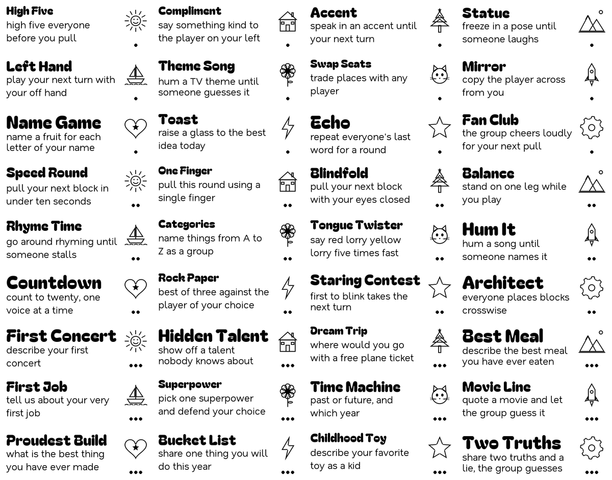
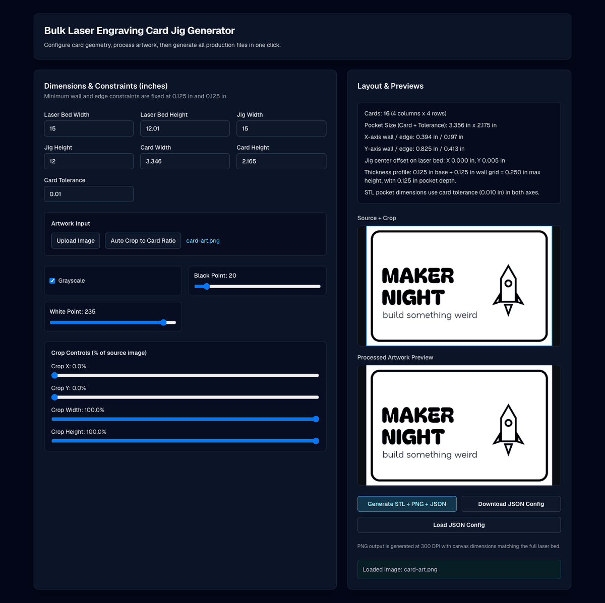
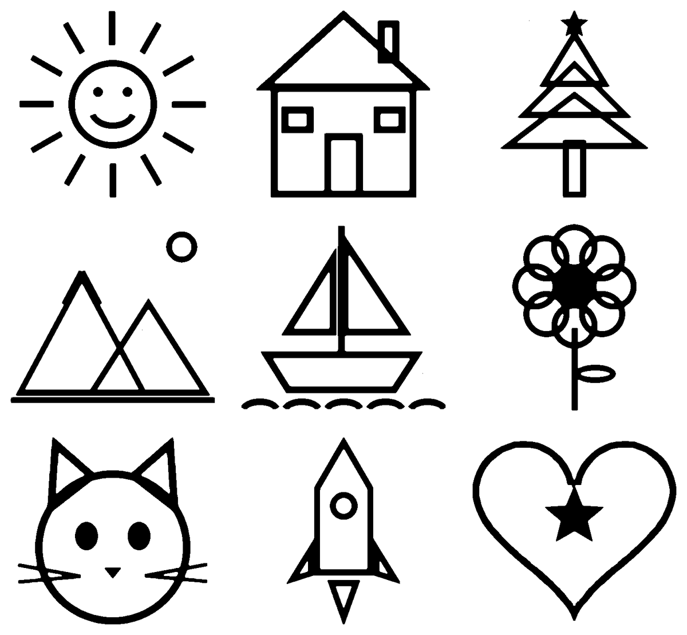
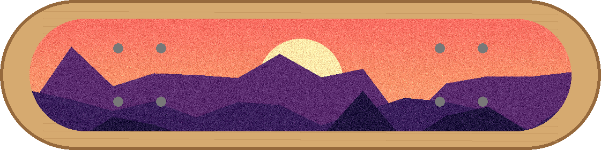

# Makerspace Tools

[](https://github.com/joey12725/makerspace-tools/actions/workflows/ci.yml)
[](LICENSE)

Four small tools that get artwork from the screen onto a laser bed or a 3D printer: custom Jenga sets, bulk-engraved cards with a printed alignment jig, 1-bit lithophane sheets, and longboard grip tape previews. Each one solves a real shop problem, ships with sample inputs, and runs in under a minute.

## Gallery

<table>
<tr>
<td width="50%" valign="top">

### [Jenga Maker](tools/jenga-maker)

A list of prompts goes in. Out come laser-ready sheets of block faces with titles, auto-fitted text, icons and category dots, plus a cut template that holds 40 blocks in register.

<a href="tools/jenga-maker"></a>

</td>
<td width="50%" valign="top">

### [Laser Card Jig](tools/laser-card-jig)

Enter bed and card dimensions, drop in artwork, and download a 3D-printable pocket tray (STL) and a full-bed laser layout (PNG) that line up exactly.

<a href="tools/laser-card-jig"></a>

</td>
</tr>
<tr>
<td width="50%" valign="top">

### [Lithophane Tiler](tools/lithophane-tiler)

Trims a folder of drawings to their ink, normalizes their size, hard-thresholds them, and packs them into a single 1-bit sheet.

<a href="tools/lithophane-tiler"></a>

</td>
<td width="50%" valign="top">

### [Longboard Grip Tape Visualizer](tools/longboard-griptape)

Masks the grip area of a deck by color, then fits, rotates, snaps and textures any artwork into it so you can see the design before cutting.

<a href="tools/longboard-griptape"></a>

</td>
</tr>
</table>

## Quickstart

The three Python tools share one [uv](https://docs.astral.sh/uv/) environment:

```bash
git clone https://github.com/joey12725/makerspace-tools.git
cd makerspace-tools
uv sync

uv run python tools/jenga-maker/make_jenga_layout.py build --root tools/jenga-maker/examples --out output/jenga
uv run python tools/lithophane-tiler/lithophane_tiler.py tools/lithophane-tiler/samples -o output/sheet.png --padding 30
uv run python tools/longboard-griptape/griptape.py tools/longboard-griptape/samples/deck.png \
    tools/longboard-griptape/samples/sunset-pattern.png -o output/griptape.png
```

The laser card jig is a Next.js app with its own `package.json`:

```bash
cd tools/laser-card-jig && npm ci && npm run dev
```

Each tool's README covers its options, inputs and internals.

## Layout

```
tools/
  jenga-maker/         Python CLI + React configurator + Vercel functions
  laser-card-jig/      Next.js app, in-browser CSG and canvas rendering
  lithophane-tiler/    Python CLI / library
  longboard-griptape/  Python library + CLI + Streamlit UI
scripts/
  make_samples.py      regenerates every sample input (all procedurally drawn)
  render_gallery.py    regenerates the images above from those samples
docs/gallery/          README images
```

## Development

```bash
uv sync                      # Python deps + pytest + ruff
uv run ruff check . && uv run ruff format --check .
uv run pytest                # all Python tools

cd tools/laser-card-jig
npm run lint && npm test && npm run build
```

CI runs both suites on every push. Each tool keeps its full commit history from when it lived in its own repository, back to August 2025.

## Tech

Python 3.10+, Pillow, NumPy, Flask, Streamlit · TypeScript, Next.js 16, React 19, Tailwind CSS 4, JSCAD, Vitest · GitHub Actions, Vercel.

## License

MIT, see [LICENSE](LICENSE). The bundled fonts in `tools/jenga-maker/fonts` are under the SIL Open Font License.

---

Built by Joey Hersh.
