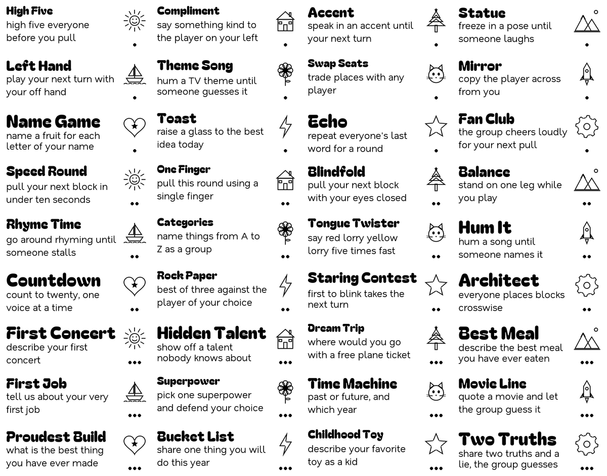
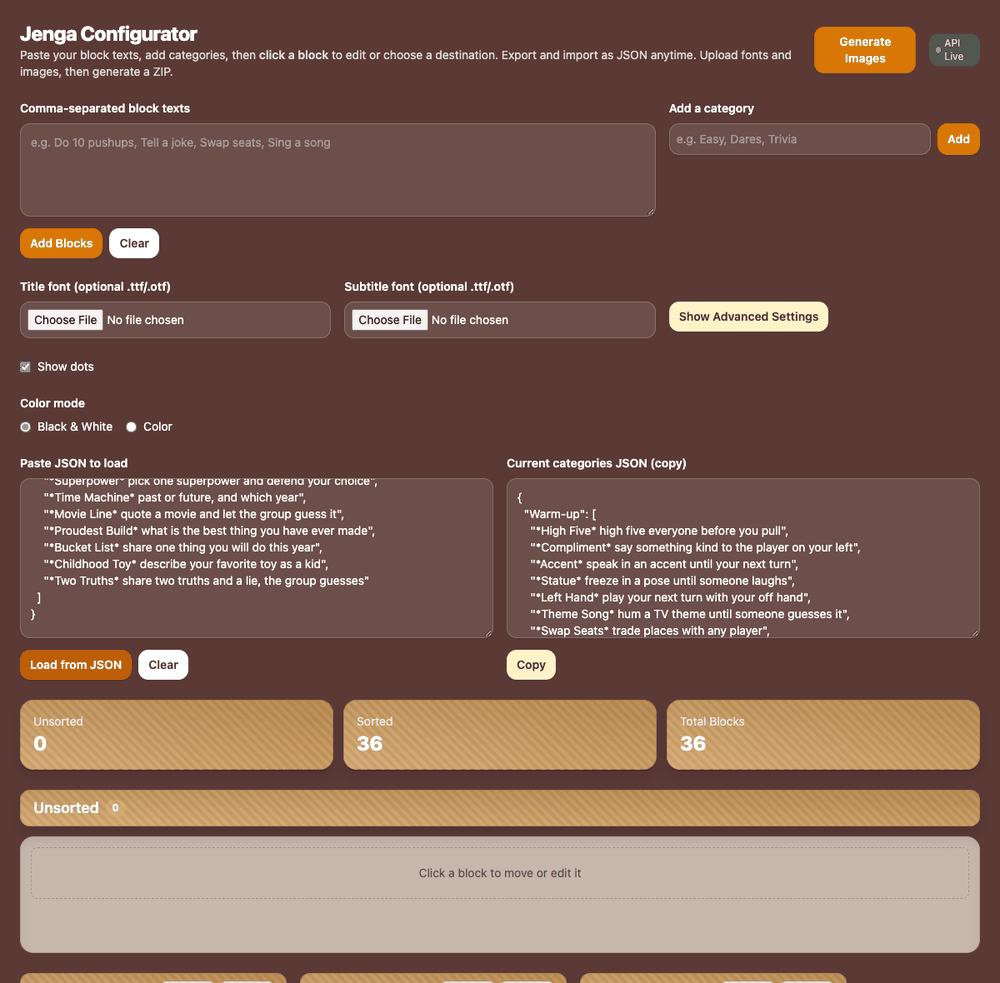

# Jenga Maker

Turn a list of prompts into a custom Jenga set. Every block gets a bold title, an auto-fitted description, an icon and category dots, laid out on laser-bed-sized sheets with a matching alignment template so 40 blocks engrave in one run.



## Quickstart

From the repo root (`uv sync` once):

```bash
cd tools/jenga-maker
uv run python make_jenga_layout.py check-images --root examples
uv run python make_jenga_layout.py build --root examples --out output
```

`output/` now holds:

| File | Use |
| --- | --- |
| `template.svg` / `template.png` | Cut this from cardboard or MDF first. It holds the blocks in place. |
| `raster_page_01.svg` / `.png` | The engrave sheet. Line it up with the template. |
| `tiles/tile_001.png` ... | One image per block face. |

### Web app

There is also a drag-and-drop configurator: paste prompts, sort them into categories, set dots and colors, upload icons and fonts, and download the whole job as a ZIP.

```bash
uv run python serve.py          # http://localhost:5050
```



It deploys to Vercel as-is (static `index.html` + `app.jsx`, Python functions in `api/`). Set the project's Root Directory to `tools/jenga-maker`.

## Your own deck

`blocks.json` maps category names to prompts. Wrap the title in asterisks; the rest becomes the description:

```json
{
  "Warm-up": ["*High Five* high five everyone before you pull"],
  "Challenge": ["*One Finger* pull this round using a single finger"]
}
```

- **Icons** go in a folder named after the category, named by the title's first word: `Warm-up/high.png`. Repeated first words get numbered (`big.png`, `big2.png`). `check-images` lists anything missing. Opaque white backgrounds are knocked out automatically.
- **Dots** mark the category: the first category gets one, the second two, and so on. Override with `--dots "warm-up=1,story=3"`.
- **Fonts**: drop `title.ttf` and `subtitle.ttf` next to `blocks.json`, or pass `--font` / `--font-bold`. The bundled defaults are Bagel Fat One and Nata Sans.
- **Geometry**: `--bed-w`, `--bed-h`, `--block-w`, `--block-h`, `--spacing`, `--page-margin` (all mm). Defaults fit a standard 75 x 25 mm block face on a 381 x 305 mm bed. Run `build --help` for the full list.

## How it works

1. Parse the deck and resolve icons.
2. Binary-search the largest description font size at which every block's text fits in three lines or fewer, so the whole set uses one consistent size.
3. Render each tile: shrink the title until title, gap and description fit the face, place the icon in a right-hand column, and center the dots under it.
4. Pack tiles into the largest grid that fits the bed and write each page as an SVG (embedded PNG tiles placed in millimeters) plus a PNG preview, along with the cut template.

The web UI posts a config and uploads to `api/generate.py`, which runs the same pipeline in a temp directory and streams back a ZIP.

## Tests

```bash
uv run pytest tools/jenga-maker
```

Covers grid packing, deck parsing, icon naming, a full build, and the HTTP API.
