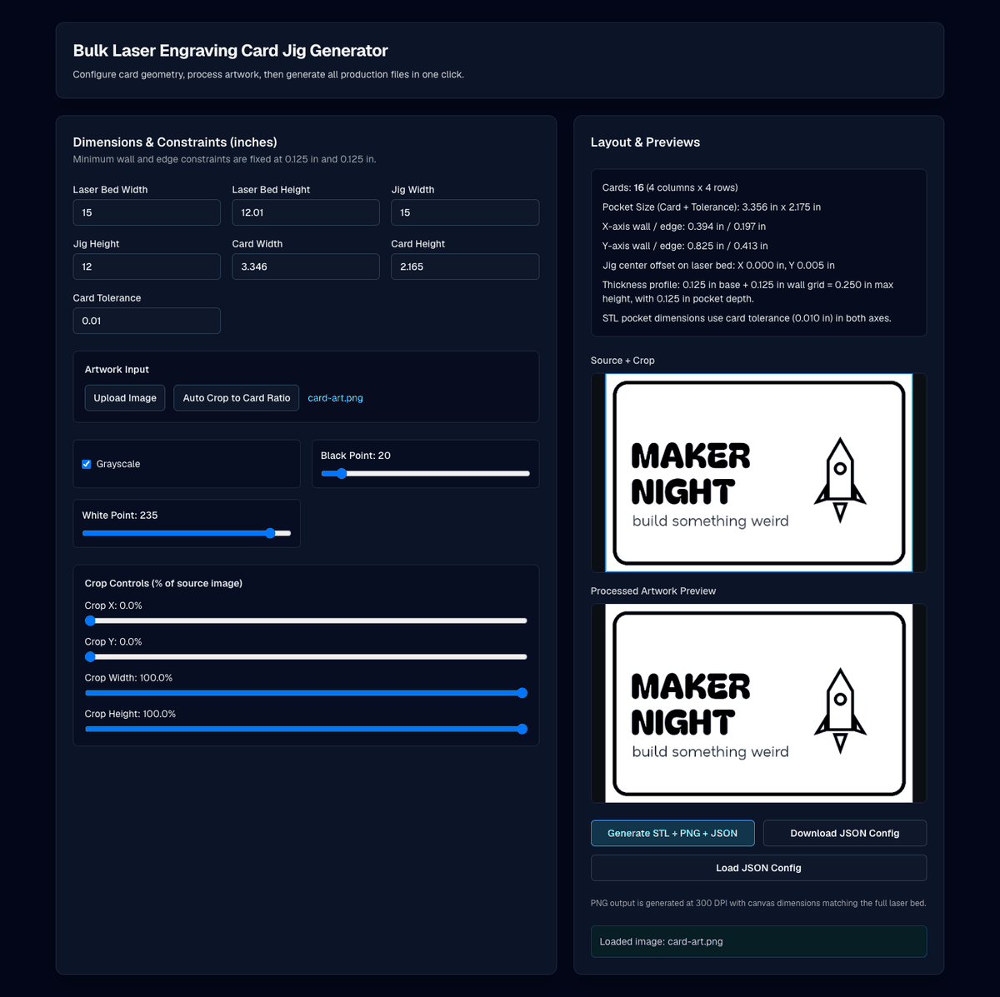
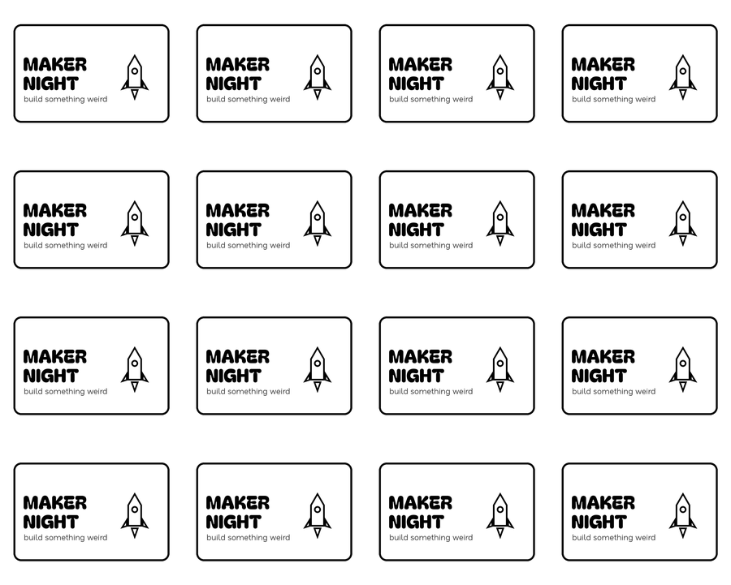

# Laser Card Jig

Engrave a whole bed of cards in one pass. Type in your laser bed and card size, drop in the artwork, and the app hands back three files that line up to the thousandth of an inch:

- **`jig_template.stl`**: a 3D-printable tray with one pocket per card
- **`laser_layout.png`**: a full-bed, 300 DPI image with the artwork placed exactly over every pocket
- **`config_<timestamp>.json`**: every setting, so you can reload the job next month



Everything runs in the browser. No server, no uploads.

## Quickstart

```bash
cd tools/laser-card-jig
npm ci
npm run dev        # http://localhost:3000
```

Click **Upload Image**, pick `samples/card-art.png`, then **Generate STL + PNG + JSON**. Print the STL, set it on the bed, load the PNG in LightBurn (or any laser software) at the bed's full size, and fire.

With the default 15 x 12 in bed and 85 x 55 mm cards you get a 4 x 4 grid of 16 cards:



## Features

- **Pocket packing** that maximizes the card count per axis while keeping every wall and outer edge at least 1/8 in thick
- **Tolerance** added to each pocket so cards drop in without forcing
- **Artwork tools**: crop by percentage, auto-crop to the card's aspect ratio, grayscale, black point and white point levels
- **Exact registration**: the PNG uses the same slot coordinates as the STL, offset to the center of the laser bed
- **Save and restore** the full configuration as JSON

## How it works

| Module | Job |
| --- | --- |
| `src/lib/layout.ts` | For each axis, start from the most cards that fit and step down until wall and edge minimums hold. Produces the slot grid in inches. |
| `src/lib/stl.ts` | Builds a 1/8 in base plate plus a 1/8 in wall grid with `@jscad/modeling` CSG, then serializes binary STL. |
| `src/lib/image-processing.ts` | Crop and level adjustments on an HTML canvas. |
| `src/lib/png.ts` | Paints the processed artwork into every slot on a bed-sized canvas. |
| `src/lib/config.ts` | Defaults plus a forgiving JSON loader that falls back to defaults for anything missing or malformed. |

The original design spec lives in [docs/spec.md](docs/spec.md).

## Checks

```bash
npm run lint
npm test           # layout math, STL geometry, config round trip
npm run build
```

## Stack

Next.js 16 (App Router), React 19, Tailwind CSS 4, TypeScript, `@jscad/modeling`, Vitest. Deploys as a static site on Vercel or anywhere else.
