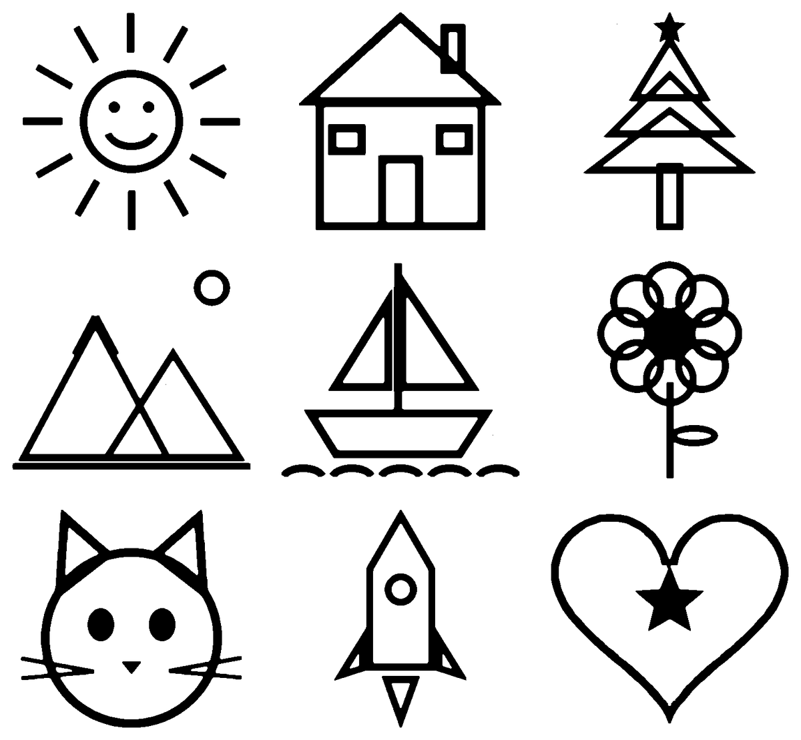

# Lithophane Tiler

Feed it a folder of drawings and get back one crisp, pure black-and-white sheet, ready for a lithophane generator or a laser engraver.



Scans, phone photos of sketches and AI line art all come in with gray paper, uneven margins and stray specks. The tiler cleans all of that up in one pass:

1. **Trims each image to its ink.** Every edge stops at the fourth dark pixel from that side, so a few specks of dust can't hold the crop open.
2. **Normalizes the size.** Every drawing is scaled into the same cell so the grid reads evenly.
3. **Hard-thresholds** to pure black and white (pixels at gray level 89 or darker, about 65% black, become ink).
4. **Packs a grid** that runs slightly wider than tall and centers a short last row.
5. **Writes a 1-bit PNG**, then `--verify` confirms there is not a single gray pixel left.

## Quickstart

From the repo root (`uv sync` once):

```bash
cd tools/lithophane-tiler
uv run python lithophane_tiler.py samples -o sheet.png --padding 30
uv run python lithophane_tiler.py --verify sheet.png
```

```
9 images -> 3x3 grid, 520x481px cells, sheet 1560x1443px
Saved sheet.png
sheet.png: 1560x1443 1
```

## Options

| Flag | Default | Effect |
| --- | --- | --- |
| `--threshold N` | `89` | Gray level (0-255) at or below which a pixel counts as ink. Raise it to keep lighter strokes. |
| `--cols N` | auto | Force a column count. |
| `--padding N` | `0` | White border around every tile, in pixels. |
| `--verify SHEET` | | Check an existing sheet is pure 1-bit and exit non-zero if not. |

Use it as a library too:

```python
from lithophane_tiler import build_sheet

sheet, layout = build_sheet(images, threshold=100, cols=4, padding=20)
```

## Samples

`samples/` holds nine procedurally drawn pictures (see `scripts/make_samples.py`), each on a different page size with gray paper and a few stray specks so every step has real work to do.

## Tests

```bash
uv run pytest tools/lithophane-tiler
```
