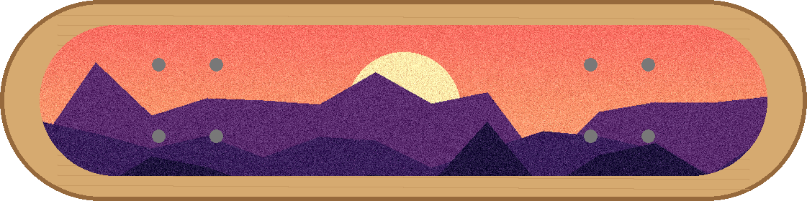

# Longboard Grip Tape Visualizer

See your custom grip tape on the deck before you cut a single sheet. Load a photo or drawing of your board with the grip area painted one solid color, load any artwork, and the visualizer masks, fits, positions and textures it so you can judge the design at full size.



## Quickstart

From the repo root:

```bash
uv sync --group ui
cd tools/longboard-griptape
uv run streamlit run app.py
```

Upload `samples/deck.png` and `samples/sunset-pattern.png`, hit **Match Width**, **Center (Box)**, then **Generate Preview** and download the PNG.

Prefer the command line?

```bash
uv run python griptape.py samples/deck.png samples/sunset-pattern.png -o preview.png --seed 7
```

## Features

- **Color-picked cutout** with a tolerance slider to catch anti-aliased edges
- **Crop and extend** the artwork, filling new space with black, white, or the averaged edge color
- **Scale** freely or snap to the cutout's width or height
- **Rotate** to any angle
- **Snap position** to the cutout's top, bottom, bounding-box center or center of mass
- **Grit**: per-pixel brightness noise that reads like real grip tape
- **Download** the finished preview as a PNG

Transforms always run in the same order (crop, extend, scale, rotate, grit) so results are predictable.

## How it works

`griptape.py` holds all of the image work as small NumPy/Pillow functions: build a boolean mask from the cutout color, run the artwork through the transform pipeline, then copy pixels into the deck wherever the mask is set and the artwork overlaps. `app.py` is a thin Streamlit layer over those functions, and the CLI's `render()` chains them for one-shot previews.

## Tests

```bash
uv run pytest tools/longboard-griptape
```

The tests import only `griptape.py`, so they run without Streamlit installed.
